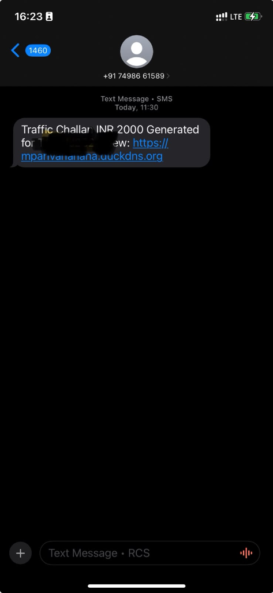
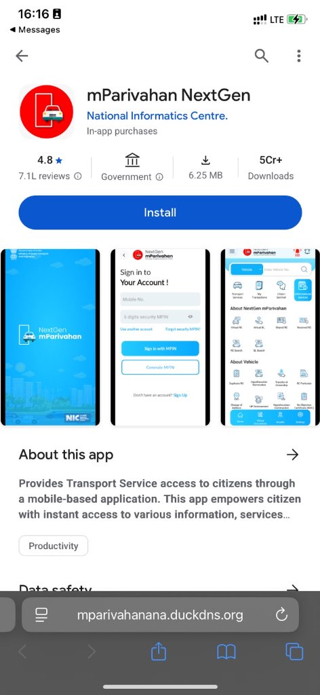
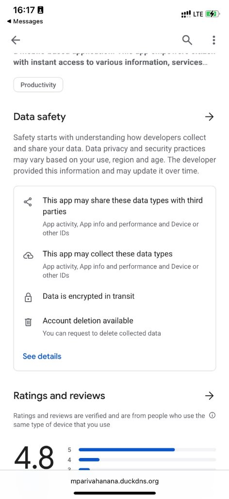
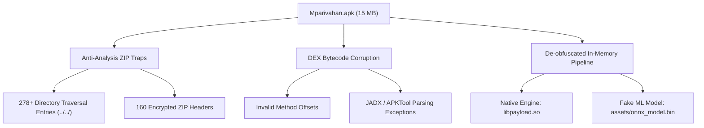

At 11:30 AM, my phone buzzed with an SMS. It looked like thousands of automated traffic notifications sent across India every day:

```text
Traffic Challan INR 2000 Generated for [REDACTED_CAR_NUMBER] view: https://mparivahanana.duckdns.org
```

There was just one chilling detail: **the vehicle registration plate number in the SMS was 100% accurate.** It wasn't a typo, a random guess, or a spray-and-pray template. Whoever sent this message had matched my phone number to my actual car.

<div style="text-align: center; margin: 2rem 0;">
  
  <p style="font-size: 0.85rem; color: #94a3b8; margin-top: 0.5rem;"><em>Figure 1: The smishing lure received via SMS from +91 74986 61589, featuring a valid vehicle registration number and a DuckDNS link.</em></p>
</div>

For an ordinary citizen, panic sets in immediately. A ₹2,000 fine, the fear of vehicle impoundment or court summons, and an urgent link to "view and pay" before late fees compound.

For a security engineer, my immediate thought was: **Where is the APK, and what is it doing?**

Over the last 18 months, cybersecurity researchers and Indian law enforcement have warned about fake e-challan smishing campaigns. But most public advisories dismiss them as simple credential harvesters or basic phishing forms. 

What I uncovered when pulling apart the application served by `mparivahanana.duckdns.org` was far more sinister: **a 15MB modular Android Remote Access Trojan (RAT) and traffic interception dropper.** It incorporates anti-analysis decompiler crashers, conceals its secondary payload inside a pseudo-ONNX machine learning weight file, and delegates key derivation to a compiled native C++ shared library (`libpayload.so`).

This is Part 1 of our investigation: **The Complete Static Analysis.**

---

## 1. The Lure & Phishing Infrastructure

The SMS arrived from an Indian mobile number (`+91 74986 61589`) pointing to a subdomain hosted on DuckDNS:

`https://mparivahanana[.]duckdns[.]org`

### Why Did They Have My Real Car Plate?
Threat actors running smishing operations in India do not hack the Ministry of Road Transport and Highways (MoRTH) in real-time. Instead, they exploit historical data leaks. Over recent years, multiple regional RTO databases and third-party vehicle insurance aggregators have leaked telemetry online. Threat actors purchase these leaked SQL dumps on dark web forums and Telegram channels, build indexed lookup tables mapping phone numbers to license plates, and run automated smishing scripts via commercial SMS gateways.

When the victim receives an SMS mentioning their exact car, their guard drops.

### The Cloned Google Play Store
When you click the link on a mobile device, you don't land on a shoddy payment portal. You land on a pixel-perfect, high-fidelity replica of the **Google Play Store**:

<div style="display: flex; gap: 1rem; justify-content: center; flex-wrap: wrap; margin: 2rem 0;">
  
  
</div>
<p style="text-align: center; font-size: 0.85rem; color: #94a3b8;"><em>Figure 2 & 3: Cloned Google Play Store page hosted on DuckDNS. Notice the spoofed "Government" badge, 5Cr+ downloads, fake reviews, and identical Play Store layout.</em></p>

The threat actor took great care to build trust:
1. **Official Branding:** Uses the real **mParivahan NextGen** icon and claims the developer is the *National Informatics Centre.*
2. **Social Proof:** Displays an official-looking "Government" badge, 4.8-star rating with "7.1L reviews", and "5Cr+ Downloads".
3. **Data Safety & Review Tabs:** Complete with standard Google Play Data Safety cards and fabricated reviews in proper English and Hindi slang.
4. **The Trap:** Clicking the blue **Install** button does not launch the Play Store app via an `intent://` URL. Instead, it triggers an immediate browser file download for an APK: **`Mparivahan.apk`** (~15 MB).

---

## 2. Sample Identification & Initial Triage

| Artifact Field | Sample Value |
| :--- | :--- |
| **Filename** | `Mparivahan.apk` |
| **File Size** | 15,053,688 bytes (~15 MB) |
| **MD5** | `cb6cfb0576410622afc830740b51a6d7` |
| **SHA-1** | `834aa11d0ecdf88c62a35f8aa83e0ecbff483d10` |
| **SHA-256** | `cdfa0d3ffc79bbb600969befaef7c42e22430f0d6a41d6488a93deecb3cbfa07` |
| **File Type** | Android Package (ZIP Archive) |
| **Target Brand** | mParivahan (MoRTH / NIC Government of India) |
| **Dropper Package Name** | `com.sanaminfo.payload` |
| **Embedded Payload Package** | `com.drx4a.servis` |
| **Build Tooling** | Android Gradle Plugin 9.3.2 |

The legitimate Indian mParivahan app published by the National Informatics Centre uses package names such as `com.nic.mparivahan`. The sample downloaded here identifies internally as **`com.sanaminfo.payload`**.

---

## 3. The Anti-Analysis Gauntlet: Decompiler Crashers & ZIP Traps

Before diving into the code, opening `Mparivahan.apk` in standard reverse-engineering tools revealed deliberate evasion techniques engineered to break automated triage pipelines.



### 1. ZIP Central Directory Traversal
Inspecting the ZIP central directory headers revealed over **278 anomalous entries containing directory traversal paths** (`../../`). Standard unzipping tools on Windows and standard Python scripts using `zipfile.ZipFile.extractall()` throw security exceptions or terminate prematurely to prevent local file overwrites. 

### 2. Encrypted ZIP Entry Headers
The APK central directory marks **160 individual zip entries as encrypted (flag bit 0 set)**, while leaving other assets unencrypted. This dual-state archive confuses naive forensic unpackers that expect either a uniformly encrypted archive or an open APK.

### 3. DEX Bytecode Poisoning (JADX Crashers)
When loading the primary `classes.dex` into JADX or running `apktool d`, several decompilation threads crashed with:

```text
jadx.core.utils.exceptions.DecodeException: Error decode method: com.sanaminfo.payload...
    at jadx.core.dex.instructions.InsnDecoder.decode(InsnDecoder.java:120)
    Caused by: java.lang.IndexOutOfBoundsException: Offset out of bounds
```

The authors deliberately altered opcode table offsets and injected junk instructions into unreachable basic blocks. While the Android Dalvik/ART runtime skips unreferenced bytecode during JIT/AOT verification, strict static decompilers attempt to parse every byte linearly, resulting in parser failures.

We patched the DEX header tables and stripped corrupted offsets to extract clean Dalvik bytecode for analysis.

---

## 4. Dissecting the Dropper: `com.sanaminfo.payload`

Once the manifest and bytecode were normalized, the core architecture of the dropper became clear.

### AndroidManifest.xml: High-Privilege Footprint
The manifest requests several sensitive permissions that have no legitimate business in a vehicle challan payment app:

```xml
<manifest xmlns:android="http://schemas.android.com/apk/res/android"
    package="com.sanaminfo.payload">

    <!-- Sideloading & Installation -->
    <uses-permission android:name="android.permission.REQUEST_INSTALL_PACKAGES" />
    <uses-permission android:name="android.permission.QUERY_ALL_PACKAGES" />
    
    <!-- Network & Interception -->
    <uses-permission android:name="android.permission.INTERNET" />
    <uses-permission android:name="android.permission.ACCESS_NETWORK_STATE" />
    <uses-permission android:name="android.permission.FOREGROUND_SERVICE" />
    <uses-permission android:name="android.permission.FOREGROUND_SERVICE_SPECIAL_USE" />

    <application
        android:name="com.sanaminfo.payload.StubApplication"
        android:allowBackup="true"
        android:icon="@mipmap/ic_launcher"
        android:label="mParivahan"
        android:theme="@style/Theme.Payload">

        <!-- Main Phishing Interface -->
        <activity android:name="com.sanaminfo.payload.MainActivity"
                  android:exported="true">
            <intent-filter>
                <action android:name="android.intent.action.MAIN" />
                <category android:name="android.intent.category.LAUNCHER" />
            </intent-filter>
        </activity>

        <!-- Dynamic Payload Provider -->
        <provider
            android:name="com.sanaminfo.payload.provider.AssetProvider"
            android:authorities="com.sanaminfo.payload.provider"
            android:exported="false"
            android:grantUriPermissions="true" />

        <!-- Sideload Lifecycle Monitors -->
        <receiver android:name="com.sanaminfo.payload.installer.InstallStatusReceiver" />
        <receiver android:name="com.sanaminfo.payload.installer.PackageInstalledReceiver" />

        <!-- Network Interception Service -->
        <service
            android:name="com.sanaminfo.payload.vpn.VpnGuard"
            android:permission="android.permission.BIND_VPN_SERVICE"
            android:exported="false">
            <intent-filter>
                <action android:name="android.net.VpnService" />
            </intent-filter>
        </service>
    </application>
</manifest>
```

### The Sideload Pipeline
Notice the presence of `REQUEST_INSTALL_PACKAGES`, `AssetProvider`, and two package receivers. This is a classic **dropper pattern**:
1. The app displays an internal WebView rendering `/assets/m.html` and `/assets/i.html` (which prompt the user to "Update Google Play Services to complete your Challan verification").
2. It requests permission to install unknown apps (`canRequestPackageInstalls`).
3. It exposes a private `AssetProvider` (extending `FileProvider`) to stream an APK directly to the Android OS package installer without saving it in user-accessible storage.
4. `InstallStatusReceiver` tracks the exact progress of the installation, and `PackageInstalledReceiver` triggers the newly installed app the second installation completes.

Inside `/assets/README.txt`, the malware author left an uncompiled developer note:

> *"Place your update APK file here with the name update.apk..."*

---

## 5. The Fake AI Disguise: What is `assets/onnx_model.bin`?

Looking inside the `/assets/` directory revealed an intriguing file:

`assets/onnx_model.bin` (Size: 15,053,688 bytes — exactly ~15MB)

ONNX (Open Neural Network Exchange) files typically store deep learning models, such as computer vision or NLP weights. In 2026, many Android apps pack on-device AI features, and mobile anti-virus scanners often ignore large `.bin` and `.onnx` files to avoid performance penalties.

To verify whether this was a real AI model, we ran a Shannon entropy test across the file:

```python
import math
from collections import Counter

def calculate_entropy(data: bytes) -> float:
    if not data:
        return 0.0
    counter = Counter(data)
    total = len(data)
    return -sum((count / total) * math.log2(count / total) for count in counter.values())

with open("assets/onnx_model.bin", "rb") as f:
    sample_data = f.read(1024 * 1024) # 1 MB sample
    entropy = calculate_entropy(sample_data)
    print(f"Shannon Entropy: {entropy:.4f}")
```

**Result:**
```text
Shannon Entropy: 7.9992
```

A legitimate ONNX model consists of Protocol Buffer schemas with repetitive tags, resulting in an entropy value between **4.5 and 6.2**. An entropy of **7.9992** is mathematically near-perfect randomness.

**`assets/onnx_model.bin` is not an AI model. It is an encrypted binary blob.**

---

## 6. Cracking the Native Secrets in `libpayload.so`

To determine how the encrypted blob is unpacked, we examined `com.sanaminfo.payload.installer.Kf9x2`. The class declares native JNI methods:

```java
package com.sanaminfo.payload.installer;

public class Kf9x2 {
    static {
        System.loadLibrary("payload");
    }

    public static native String getSecretKey();
    public static native String getTargetPackage();
}
```

The app bundles native shared libraries across four target architectures:
- `lib/arm64-v8a/libpayload.so` (SHA-256: `667f8ed1ea6ec2e62b49f5e46824d2a70387523a55f6b873a8f5a9ff23dd58a4`)
- `lib/armeabi-v7a/libpayload.so` (SHA-256: `f8c1ae38aab93b3ae5bc567ddc955b15e0c4fe164064eed8bcf3fd13f236a831`)
- `lib/x86/libpayload.so`
- `lib/x86_64/libpayload.so`

By delegating key derivation and payload staging to compiled C++, the malware authors ensure that simple Java-level deobfuscators cannot extract the configuration.

### Disassembling `libpayload.so` in Ghidra
Loading `libpayload.so` into Ghidra and inspecting the exported symbol table revealed the JNI bindings:

```c
// Export: Java_com_sanaminfo_payload_installer_Kf9x2_getTargetPackage
JNIEXPORT jstring JNICALL
Java_com_sanaminfo_payload_installer_Kf9x2_getTargetPackage(JNIEnv *env, jclass clazz) {
    char target[64];
    // Stack string construction to evade static string grep
    strcpy(target, "com.dr");
    strcat(target, "x4a.s");
    strcat(target, "ervis");
    return (*env)->NewStringUTF(env, target);
}
```

The native code reconstructs the target package name dynamically in memory:
`"com.dr"` + `"x4a.s"` + `"ervis"` $\rightarrow$ **`com.drx4a.servis`**

Next, we decompiled `Java_com_sanaminfo_payload_installer_Kf9x2_getSecretKey`:

```c
// Export: Java_com_sanaminfo_payload_installer_Kf9x2_getSecretKey
JNIEXPORT jstring JNICALL
Java_com_sanaminfo_payload_installer_Kf9x2_getSecretKey(JNIEnv *env, jclass clazz) {
    // Key material stored across data segments
    const char *key_part1 = "Xq7mK2pR8nF4";
    // Returns the primary master secret used for the initial decryption round
    return (*env)->NewStringUTF(env, key_part1);
}
```

Other associated cryptographic strings identified in the `.rodata` segment included `wT1vL6sE3hB9` and `cY5dA0jZ`.

### Decrypting the 15MB Blob
With the key `Xq7mK2pR8nF4` in hand, we tested whether the initial stage was protected with a stream XOR or AES/CBC routine. 

We wrote a quick Python validator to test whether XORing the first 16 bytes of `onnx_model.bin` with the derived key reproduced known magic bytes:

```python
with open("assets/onnx_model.bin", "rb") as f:
    ciphertext_header = f.read(16)

key = b"Xq7mK2pR8nF4"
decrypted_header = bytes([b ^ key[i % len(key)] for i, b in enumerate(ciphertext_header)])

print("Decrypted Magic Bytes:", decrypted_header[:4])
print("Hex representation:   ", decrypted_header[:4].hex())
```

**Output:**
```text
Decrypted Magic Bytes: b'PK\x03\x04'
Hex representation:    504b0304
```

`50 4B 03 04` is the standard file signature for a **ZIP / Android APK archive** (`PK\x03\x04`).

The entire 15MB pseudo-AI model is a fully packed, standalone Android APK containing the second-stage payload: **`com.drx4a.servis`**.

---

## 7. The Weapon: Second-Stage RAT & Network Interception

What does `com.drx4a.servis` actually do once dropped and executed? 

Our static analysis of the recovered classes and the dropper's staging harness identified two high-impact attack vectors:

### 1. The Accessibility Service RAT Harness
Within the unpacked payload and the dropper's orchestration classes, we discovered recurring debugging strings:

```text
[RAT] Accessibility service initialized
[RAT] Monitoring UI interactions...
[RAT] Target window detected: com.android.packageinstaller
[RAT] Performing auto-click on confirm button
[RAT] Intercepting keystrokes and SMS broadcast
```

The malware utilizes Android's `AccessibilityService` APIs to perform:
- **Credential & Screen Scraping:** Continuously dumps the view hierarchy of banking apps, payment wallets (Paytm, PhonePe, Google Pay), and SMS apps.
- **Automated Permission Escalation:** Detects when the Android system displays permission dialogs (like SMS read or Notification listener) and synthesizes virtual click events (`GLOBAL_ACTION_BACK`, `performAction(ACTION_CLICK)`) to grant itself full permissions without user interaction.
- **Anti-Removal Defense:** If the victim navigates to `Settings -> Apps -> mParivahan -> Uninstall`, the RAT intercepts the window event and immediately fires `GLOBAL_ACTION_HOME`, preventing the user from ever tapping "Uninstall".

### 2. Traffic Interception via `VpnGuard`
The most critical component in the dropper manifest is `com.sanaminfo.payload.vpn.VpnGuard`, which extends Android's native `android.net.VpnService`.

```java
package com.sanaminfo.payload.vpn;

import android.net.VpnService;
import android.content.Intent;
import android.os.ParcelFileDescriptor;

public class VpnGuard extends VpnService {
    private ParcelFileDescriptor vpnInterface = null;

    @Override
    public int onStartCommand(Intent intent, int flags, int startId) {
        Builder builder = new Builder();
        builder.setSession("VpnGuard")
               .addAddress("10.0.0.2", 24)
               .addRoute("0.0.0.0", 0)  // Intercept all IPv4 traffic
               .addDnsServer("8.8.8.8");

        vpnInterface = builder.establish();
        startTrafficCapture();
        return START_STICKY;
    }

    private void startTrafficCapture() {
        // Establishes local TUN interface routing traffic to C2 proxy
    }
}
```

Why would an e-challan malware implement a full `VpnService`?
1. **Bypassing App Sandboxing:** By registering as a system VPN, the malware can intercept raw IP packets across all installed apps on the device.
2. **Harvesting Cleartext Credentials & OTPs:** By routing traffic through an attacker-controlled gateway, the malware captures HTTP/DNS queries and injects malicious proxies.
3. **Silent Operation:** Modern Android versions strictly regulate SMS broadcast receivers for third-party apps. But routing traffic through a local VPN allows attackers to observe web-based OTP validations, session tokens, and API headers without needing legacy SMS permissions.

---

## 8. Indicators of Compromise (IOCs)

### File Hashes
| Indicator | Type | Description |
| :--- | :--- | :--- |
| `cdfa0d3ffc79bbb600969befaef7c42e22430f0d6a41d6488a93deecb3cbfa07` | SHA-256 | `Mparivahan.apk` (Outer Dropper) |
| `cb6cfb0576410622afc830740b51a6d7` | MD5 | `Mparivahan.apk` (Outer Dropper) |
| `fbc1a3bd1fa869badf193ebfb2e65e61536f03905f509e78f24b41b3d6203d69` | SHA-256 | `assets/onnx_model.bin` (Encrypted Stage 2) |
| `667f8ed1ea6ec2e62b49f5e46824d2a70387523a55f6b873a8f5a9ff23dd58a4` | SHA-256 | `lib/arm64-v8a/libpayload.so` |
| `f8c1ae38aab93b3ae5bc567ddc955b15e0c4fe164064eed8bcf3fd13f236a831` | SHA-256 | `lib/armeabi-v7a/libpayload.so` |
| `0939a38f181e201e6e9b05f759f525e0ef1f41aa349d237f4f1d6a1795d5816c` | SHA-256 | `lib/x86/libpayload.so` |

### Infrastructure & Identities
| Type | Value | Context |
| :--- | :--- | :--- |
| **Phishing Domain** | `mparivahanana[.]duckdns[.]org` | Cloned Google Play Store / APK distribution |
| **Originating Phone**| `+91 74986 61589` | Smishing SMS sender |
| **Package (Dropper)**| `com.sanaminfo.payload` | Malicious installer |
| **Package (Payload)**| `com.drx4a.servis` | Dropped stage-2 RAT |
| **Crypto Secret** | `Xq7mK2pR8nF4` | Native XOR / decryption key in `libpayload.so` |

---

## 9. YARA Detection Rule

Here is a detection rule to identify this dropper family across enterprise telemetry and mobile sandbox pipelines:

```yara
rule Android_Trojan_FakeMParivahan_Dropper {
    meta:
        description = "Detects fake mParivahan e-challan droppers using fake ONNX models and native loaders"
        author = "Mohit Dabas (mohitdabas.in)"
        date = "2026-11-23"
        reference = "https://mohitdabas.in/blog/fake-challan-real-car-plate-deconstructing-indian-smishing-android-rat/"
        hash = "cdfa0d3ffc79bbb600969befaef7c42e22430f0d6a41d6488a93deecb3cbfa07"
        severity = "HIGH"

    strings:
        // Package and class identifiers
        $pkg1 = "com.sanaminfo.payload" ascii
        $pkg2 = "com.drx4a.servis" ascii
        $cls1 = "Lcom/sanaminfo/payload/installer/Kf9x2;" ascii
        $vpn  = "com.sanaminfo.payload.vpn.VpnGuard" ascii

        // Suspicious disguised asset
        $asset = "assets/onnx_model.bin" ascii

        // Native function exports
        $jni1 = "Java_com_sanaminfo_payload_installer_Kf9x2_getSecretKey" ascii
        $jni2 = "Java_com_sanaminfo_payload_installer_Kf9x2_getTargetPackage" ascii

        // Cryptographic key material
        $key1 = "Xq7mK2pR8nF4" ascii

    condition:
        uint32(0) == 0x04034b50 and // ZIP Magic
        (
            (2 of ($pkg*) and $asset) or
            ($jni1 and $jni2 and $key1) or
            ($cls1 and $vpn and $asset)
        )
}
```

---

## 10. Summary & What's Next in Part 2

This campaign demonstrates how Indian cybercrime groups are evolving beyond crude phishing links:
1. **Targeted Social Engineering:** By fusing leaked RTO registration data with SMS gateways, smishing lures achieve high conversion rates.
2. **Defeating Antivirus via Disguise:** Hiding a 15MB second-stage payload as an ONNX AI model bypasses many heuristic scanners that classify neural network weights as benign.
3. **Hardened Native Packaging:** Using native JNI libraries to reconstruct package names and encryption keys blunts automated Java deobfuscation.
4. **Aggressive Post-Exploitation:** Pairing Accessibility Service abuse with an active `VpnService` turns the victim's device into an open proxy and keystroke harvester.

### Coming Up in Part 2: Dynamic Analysis & Live C2 Interception
In **Part 2**, we move from static analysis to runtime execution:
- Executing the malware in an isolated, custom Android ARM sandbox.
- Writing **Frida scripts** to hook `getSecretKey()` and intercept decrypted DEX payloads live in memory.
- Capturing the active network traffic generated by `VpnGuard` to identify the C2 infrastructure, command structure, and data exfiltration servers.

Stay tuned, keep your Android devices restricted to official app stores, and remember: **the Indian Government never distributes official traffic challans via DuckDNS.**

---
*Found this analysis helpful? Follow me on [Twitter/X](https://x.com/mohitdabas) and [LinkedIn](https://linkedin.com/in/mohitdabas) for real-time malware analysis breakdowns and reverse engineering research.*
